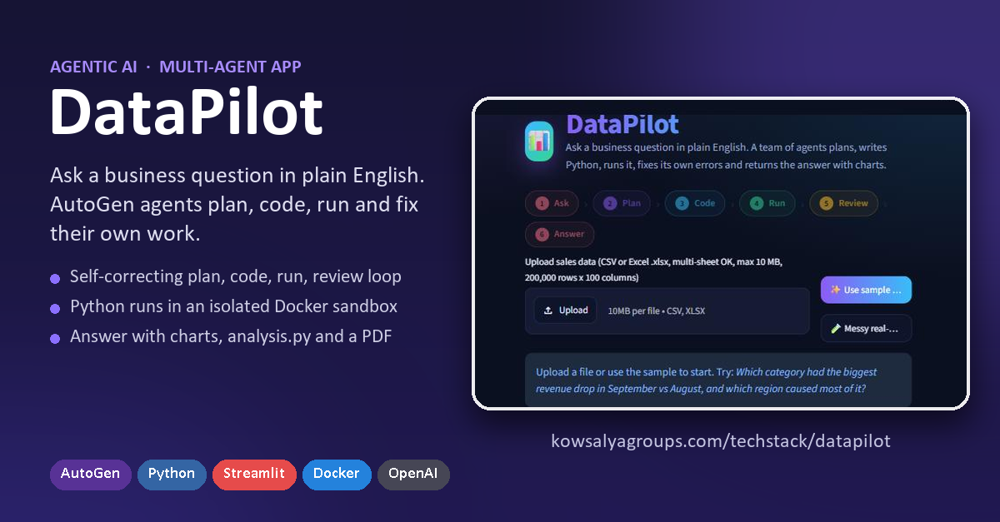
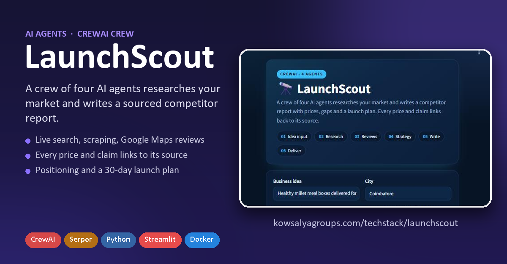
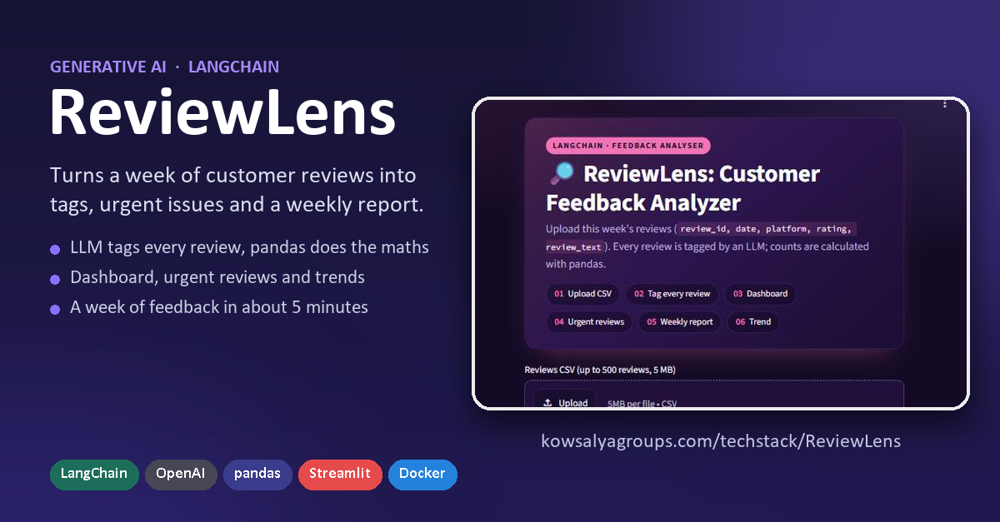
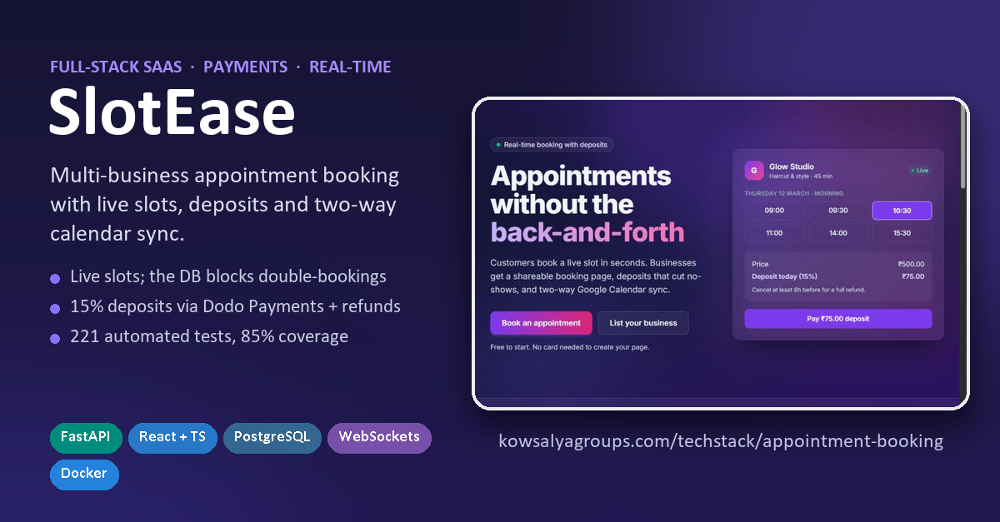
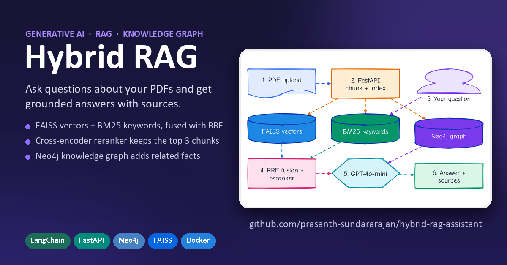

# Hi, I'm Prasanth Sundararajan 👋

**Generative AI · Agentic AI · AI Agents · AI Automation · Senior SRE** · 10+ years · Chennai, India

I spent a decade keeping production systems reliable, secure and cost-efficient at Optum, DTCC, Innova and EIT Services (DXC Technology). Now I build **Generative AI apps, AI agents and AI automations** that are ready for production, not just a notebook. Four of them are live.

## 🚀 Featured projects

Four of these are live, each with a case study on my **[portfolio](https://www.kowsalyagroups.com/prasanth/portfolio/)**.

<table>
<tr><td width="50%" valign="top"> <b>DataPilot</b>: AutoGen agents plan, code, run and fix their own data analysis. [🌐 Live demo](https://www.kowsalyagroups.com/techstack/datapilot/) · [💻 Code](https://github.com/prasanth-sundararajan/datapilot)</td><td width="50%" valign="top"> <b>LaunchScout</b>: A CrewAI crew of four agents writes a sourced competitor report. [🌐 Live demo](https://www.kowsalyagroups.com/techstack/launchscout/) · [💻 Code](https://github.com/prasanth-sundararajan/launchscout)</td></tr>
<tr><td width="50%" valign="top"> <b>ReviewLens</b>: LangChain turns a week of customer reviews into tagged insights. [🌐 Live demo](https://www.kowsalyagroups.com/techstack/ReviewLens/) · [💻 Code](https://github.com/prasanth-sundararajan/reviewlens)</td><td width="50%" valign="top"> <b>SlotEase</b>: Booking SaaS with live slots, deposits and Google Calendar sync. [🌐 Live demo](https://www.kowsalyagroups.com/techstack/appointment-booking/) · [💻 Code](https://github.com/prasanth-sundararajan/appointment-booking)</td></tr>
<tr><td width="50%" valign="top"> <b>Hybrid RAG Assistant</b>: FAISS + BM25 retrieval, reranking and a Neo4j knowledge graph. [💻 Code](https://github.com/prasanth-sundararajan/hybrid-rag-assistant)</td></tr>
</table>

## What I build

- **Generative AI:** RAG with embeddings, hybrid search, reranking and knowledge graphs; LLM fine-tuning
- **Agentic AI and AI agents:** multi-agent systems with LangGraph, CrewAI, AutoGen and MCP
- **AI automation:** n8n and Python workflows connecting LLMs to Telegram, Slack, Gmail, Google Workspace and LinkedIn
- **LLMOps and SRE:** tracing, evaluation, guardrails and reliable deployment with Docker, Kubernetes and AWS

## More AI projects

| Project | What it does | Stack |
|---|---|---|
| [TNAU Agri Schemes AI Assistant](https://github.com/prasanth-sundararajan/TNAU-Agri-Schemes-AI-Assistant) | Tamil/English assistant for agriculture schemes with multimodal PDF ingestion | LangChain, Chroma, GPT-4o-mini vision |
| [TN Gov Schemes Knowledge Graph](https://github.com/prasanth-sundararajan/tngov_Knowledge_Graph) | GraphRAG over government schemes: scraped pages to graph to answers | Neo4j, NetworkX, Playwright |
| [Two-Agent Tech Newsletter](https://github.com/prasanth-sundararajan/Two-Agent-Crew-for-a-Tech-Newsletter) | Researcher + writer agents produce a daily tech newsletter | CrewAI, Serper |
| [Telegram AI Assistant](https://github.com/prasanth-sundararajan/Telegram-AI-Assistant-Bot) | One Telegram chat controls Calendar, Gmail, Sheets, Docs and web search | n8n AI Agent |
| [LinkedIn Post Approval](https://github.com/prasanth-sundararajan/LinkedIn-Post-Approval-Workflow-Using-n8n) | Writer and reviewer agents with human approval by email | n8n, Gmail, Sheets |
| [Multi-PDF Q&A with Sources](https://github.com/prasanth-sundararajan/multi-rag) | Answers across many PDFs with file + page citations | LangChain, Chroma |
| [LangSmith Tracing Demo](https://github.com/prasanth-sundararajan/traced-app) | Token and latency observability for LLM calls | LangChain, LangSmith |

## Tech stack

**AI:**        

**Data:**    

**Apps:**     

**Platform:**        

## Open to

Senior / Lead SRE · AI Platform Architect · Forward Deployed Engineer · Generative AI and Agentic AI Engineer roles, Chennai or hybrid.
